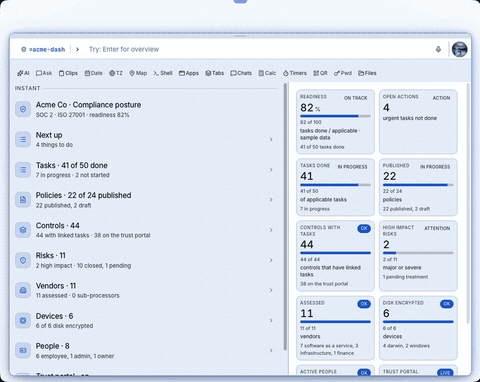

# Bolt Apps

> **Apps built before this change:** remove the old app in Bolt (Settings, Desktop App, User Apps; the Remove button is on the app's row on 181, and newer builds also show it in the expanded panel; do not delete files by hand), run `./bolt-apps new <template> <id>`, copy your own `config.json` and `fixtures.json` over the new ones, re-run `./bolt-apps check`, then `./bolt-apps ship`.

Small things people add to [Bolt](https://sparcle.app/bolt/) to do their job faster: a
snippet that cleans a list, a search prefix for a site you use every day, a launcher key
that turns pasted CSV into a Markdown table.

> **The gallery is not open yet.** You can read everything here, use the toolkit and build apps for yourself today.
> This repository will become the community gallery of Bolt Apps. It opens only when
> Bolt enforces each app's declared permissions at run time and shows them in plain
> words when you install it, and when the rules and docs here are final. App submissions
> open later. Fixes to the toolkit, the kit, the examples and the docs are welcome as pull
> requests under Apache-2.0 with a Developer Certificate of Origin sign-off (`git commit -s`).
> Pull requests that add a new app to `apps/` are closed until the gallery opens.

## What a Bolt App is

Bolt Apps extend what Bolt can do. Start with a snippet or a search prefix. Add a YAML file that
reshapes or recognizes what you paste. For your own use you can also add a command or script that
returns rows (the [toolkit](toolkit/README.md) packs it with `--personal`); the gallery takes tier 1
and 2 apps only, so that kind stays yours. Skills and agents import from Settings, Agents, Import.
Connectors, detectors and compliance packs are for company admins. Every app has a safety tier, so
you know what it can reach before you add it.

In this repository:

A Bolt App is a folder under [`apps/`](apps/) holding one or more of the things Bolt can
load, plus a `bolt-app.json` that describes it and carries its tests. It can be packed
into a **Boltpack** (`.boltpack`), the signed file Bolt installs.

| What an app can hold | Folder | What it does |
|---|---|---|
| Snippet | `snippets/` | Text you type as `;key`, with fill-in fields and filters |
| Search engine | `search_engines/` | A prefix that searches a site |
| User App | `utilities/` | A launcher `=key` that reshapes what you paste (`runtime: transform`) |

Bolt supports more kinds than these (skills, agents, connectors, detectors, compliance
packs). The gallery starts with the three above. See
[Extend Bolt](https://sparcle.app/docs/extend/) for everything Bolt can load today.

## See it in action





Every picture is a folder you can copy from [`kit/examples/`](kit/examples/). See which key draws what in [Anatomy of a Bolt App](docs/anatomy.md), and all screens in the [gallery](docs/gallery.md).

## Safety tiers

Every app has a tier. The checker works it out from the content and refuses an app that
claims a lower one.

| Tier | Means | In this gallery |
|---|---|---|
| 1 | **Data only.** Text and links: snippets, search engines. | Accepted after the check and a quick human look |
| 2 | **Acts inside Bolt** on what you paste or type, with the permissions it declares shown when you add it. No commands, no network. | Accepted after the check and a quick human look |
| 3 | **Touches your system or the network.** Runs commands, reads files, calls outside services, gives an AI agent tools. | Only when **Reviewed by Sparcle**, or approved inside your own company. Never accepted from the community without that review. |

**Reviewed by Sparcle** means Sparcle checked this version's declared permissions and
behaviour. It is not a guarantee.

A company's device settings win over any app, on macOS and Windows; Linux has no managed
device policy yet. An admin can allow only approved apps.

## Installing an app

When the gallery opens, you will add an app from Bolt or from
[sparcle.app](https://sparcle.app/docs/extend/gallery/). Until then you can copy an app by
hand:

- **Snippet:** Settings, Search & Commands, Snippets, Add snippet; paste the `content`.
- **Search engine:** Settings, Search & Commands, Search Engines, Add engine.
- **User App:** Open Settings, then Desktop App. If User Apps is hidden, switch Settings to
  Advanced. Under User Apps, click Open folder, save the `.yaml` there, and click Reload.
  If the app says Needs approval, expand its row, choose Review and accept, and review
  the files before clicking Accept. Bolt 0.1.181 shows this step for a manually installed
  transform such as [CSV to Markdown](apps/csv-to-markdown).

## Toolkit: build your own

The [`toolkit/`](toolkit/) folder holds `bolt-apps`, a small command that scaffolds an app from a
working template, lints it, signs it and packs it into a `.boltpack` you can drop on Bolt. No
account and no dependencies; see [toolkit/README.md](toolkit/README.md).

```
./bolt-apps new my-app --type transform
./bolt-apps lint apps/my-app
./bolt-apps keygen
./bolt-apps pack apps/my-app
```

For apps that run a script (not accepted in the gallery), the [authoring kit](kit/) and its [design](docs/kit-design.md) take care of formatting, row structure and JSON output.

### A rich app for a web API, in minutes

Short version: [kit/examples/QUICKSTART.md](kit/examples/QUICKSTART.md) (decision tree, four commands, ten rules). What works and what does not: [CAPABILITIES.md](kit/examples/CAPABILITIES.md). In this README `bolt-apps` means `./bolt-apps`, run from the root of the clone.

Needs Node 18+ and Python 3.9+. Want tiles, drill down with Back, a detail panel, a cache and plain error rows for a web API? Copy
[`kit/examples/portal-template`](kit/examples/portal-template), make a copy with `bolt-apps new` (it renames every file for your app; pick a distinctive app id, since two authors who both ship `weather` still collide), change data in
`scripts/my-app__config.json` and `scripts/my-app__fixtures.json`, generate the YAML, then check and pack it for yourself:

```
./bolt-apps new portal-template my-app --dir ~/my-apps
# edit ~/my-apps/my-app/scripts/my-app__config.json and fixtures.json, then regenerate the app file:
# cd ~/my-apps/my-app && python3 scripts/my-app__engine.py --emit-yaml > utilities/my-app.yaml
# (an app made with new --thin has no engine copy: run ./bolt-apps regen ~/my-apps/my-app instead)
./bolt-apps run ~/my-apps/my-app --sample
./bolt-apps ship ~/my-apps/my-app
```

Drop the `.boltpack` on the Bolt launcher or Bolt Apps; Bolt shows the review card (it rates a personal app high risk and says the pack is self-signed: both expected; install it), then Bolt's own "Install an unverified Bolt pack?" dialog (click Install). Then open Settings, Desktop App, User Apps, expand the app and click Review and accept; every reship needs that again. `ship` raises the version each time (Bolt refuses a pack that is not newer than the installed one) and keeps one signing key. This personal pack is how a rich app ships: it runs a script and calls the network (tier 3), so the gallery does not take it.
[`kit/examples/acme-dash`](kit/examples/acme-dash) shows the same template with 8 views and three levels.
Walkthrough with the row formats: <https://sparcle.app/docs/extend/rich-apps/>. Agents: [AGENTS.md](AGENTS.md) section 4c.

## Contributing

App submissions are not open yet (see the note at the top); fixes to the toolkit, kit, examples and docs are welcome now. When the gallery opens:

1. Build the app in Bolt with made-up data.
2. Run `bolt-apps check` on its folder ([CHECKER.md](CHECKER.md)).
3. Open a pull request using the template, with every commit signed off.

Read [CONTRIBUTING.md](CONTRIBUTING.md) if you are a person and [AGENTS.md](AGENTS.md) if
you are an AI coding agent.

## Credit for authors

Authors get recognition, not money:

- your name and link on the app's card and on Bolt's install screen;
- an author profile with the apps you made;
- badges, such as first app, Reviewed by Sparcle, and community favourite;
- an "added N times" count;
- a monthly spotlight, only if you tick the consent box in your pull request.

Thumbs-up reactions and counts are recognition only. Nothing depends on them.

## Community

- **Vote** with a thumbs-up on an app's pull request or its tracking issue.
- **Talk** in GitHub Discussions: Ideas, Show and tell, Q&A, Reviews.
- **Ranking:** `RANKING.md` and `INDEX.json` are generated by a workflow from reactions and
  gallery fetch counts. They are not in the repository yet. They hold no personal data and
  decide nothing.

## Security

Do not report a security problem in a public issue. See [SECURITY.md](SECURITY.md).

## Legal

[Licence](LICENSE) (Apache 2.0) and [NOTICE](NOTICE), [third-party notices](THIRD-PARTY-NOTICES.md)
for the data the examples show, [privacy of this repository](PRIVACY.md), [trademarks](TRADEMARKS.md),
and [legal notes](docs/LEGAL.md) (as is, no safety use). Company policies:
[privacy](https://sparcle.app/privacy/) and [terms](https://sparcle.app/terms/). The Apache licence
covers this repository, not the Bolt application.

**Apps you build:** this repository is Apache-2.0 open source and contributions to the toolkit, kit, examples and docs are welcome under the same licence (DCO sign-off); new apps in the gallery are not open yet. An app you build with it is yours: you choose its licence (open source, internal or commercial). If you copy kit or engine code into your app, keep the Apache-2.0 notice (a copy of the LICENSE file) with that code. Bolt, the desktop application, is proprietary and is not part of this repo; apps Sparcle ships inside Bolt are Sparcle's unless their folder says otherwise. More in [legal notes](docs/LEGAL.md).

## Licence

[Apache License 2.0](LICENSE). Contributions are made under the same licence, with a
[Developer Certificate of Origin](https://developercertificate.org/) sign-off on every
commit; see [CONTRIBUTING.md](CONTRIBUTING.md).
