# See it in action

Bolt screens for each example app. Most of the pictures are unedited captures of a real Bolt running the example on its own sample data; three are drawn by Bolt's own pane renderer from the same sample data, and each of those entries says so. Sample data is labelled in the pictures (SAMPLE chips or rows). Each entry names the example folder under `kit/examples/` and the row in [`kit/examples/capabilities.json`](../kit/examples/capabilities.json). The key behind each number is in [Anatomy of a Bolt App](anatomy.md). The 76 second video, with captions, is on the site: [sparcle.app/docs/extend/rich-apps](https://sparcle.app/docs/extend/rich-apps).

This page is generated from `docs/gallery.json`, which the website reads too.

## Tiles over a bin fill heat map

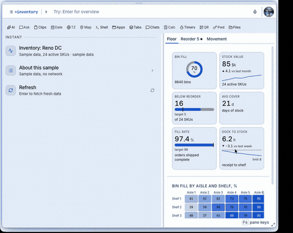

The inventory app, Floor tab: six tiles (bin fill, stock value, below reorder, average cover, fill rate, dock to stock) over a bin fill heat map by aisle and shelf, then the Reorder tab as a low stock table with bars and marks. The heat map needs Bolt 0.1.182 or newer, the tile visuals and the table bars 0.1.184, and the tabs 0.1.185, which is not in a public release yet. The pictures are unedited captures of a real Bolt running this example on its sample data.

- Example: [`inventory`](../kit/examples/inventory)
- Capability row: `widget.heatmap` (0.1.182), `widget.cards` (0.1.181), `pane.tile_visuals` (0.1.184), `widget.tabs` (0.1.185)
- How to get this: Copy `kit/examples/inventory`; the Floor tab is a `kind: stack` with a `kind: cards` child and a `kind: heatmap` child (0.1.182).

## A margin ring, a marked trend and the numbers

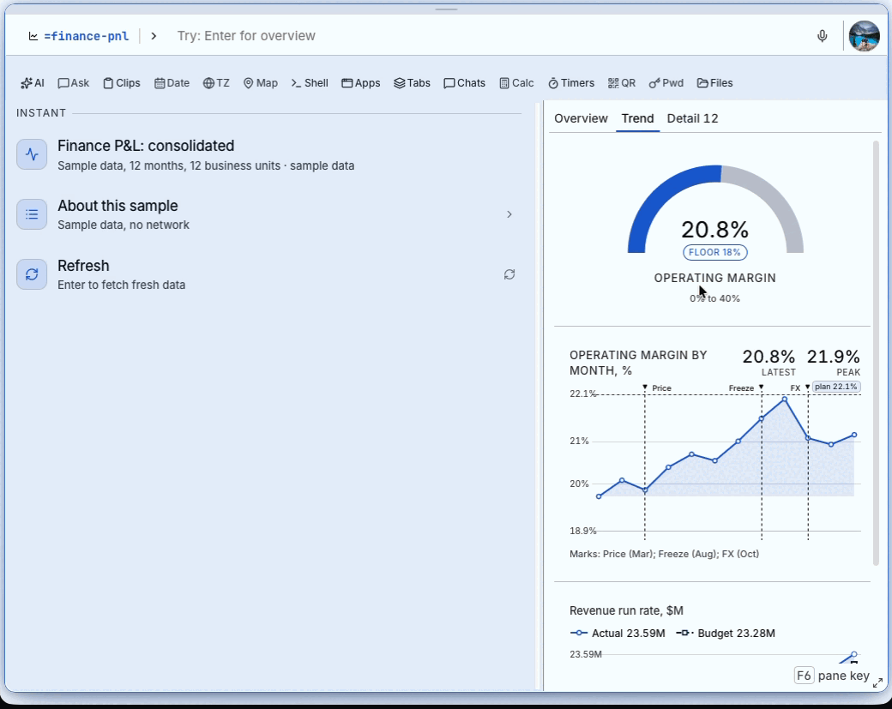
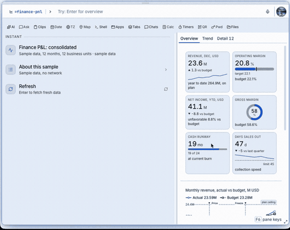

The finance app, Trend tab: the operating margin as a gauge, then the margin by month as a line against a plan line with the Price, Freeze and FX marks, then the revenue run rate as an area chart. The animation walks the Overview tiles, this Trend tab and the Detail table. The gauge pane needs Bolt 0.1.182 or newer, the chart limit line and the marks 0.1.184, and the tabs 0.1.185, which is not in a public release yet. The pictures are unedited captures of a real Bolt running this example on its sample data.

- Example: [`finance-pnl`](../kit/examples/finance-pnl)
- Capability row: `widget.gauge` (0.1.182), `widget.chart` (0.1.181), `pane.chart_limit_marker` (0.1.184), `widget.tabs` (0.1.185)
- How to get this: Copy `kit/examples/finance-pnl`; the Trend tab is a `kind: stack` with a `kind: gauge` child (0.1.182) and two `kind: chart` children, one of them with `limit` and `marker`.

## A variance table with bars and marks

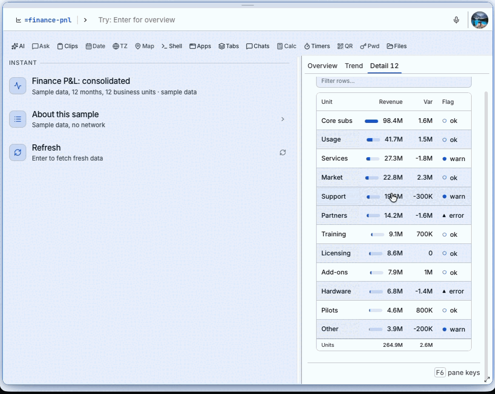

The finance app, Detail tab: the twelve business units with the revenue of each as a bar, the variance against plan and a tone mark per row. The table bars and the marks need Bolt 0.1.184 or newer and the tabs 0.1.185, which is not in a public release yet. The picture is an unedited capture of a real Bolt running this example on its sample data.

- Example: [`finance-pnl`](../kit/examples/finance-pnl)
- Capability row: `widget.table` (0.1.181), `pane.table_bars_mark` (0.1.184), `widget.tabs` (0.1.185)
- How to get this: Copy `kit/examples/finance-pnl`; the Detail tab table gives one column `bars` and one column `mark`.

## A queue table with bars and marks, then an SLA ring

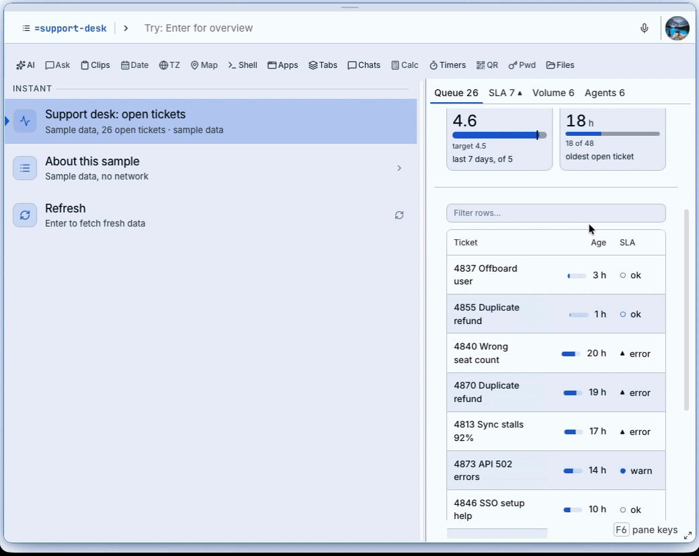
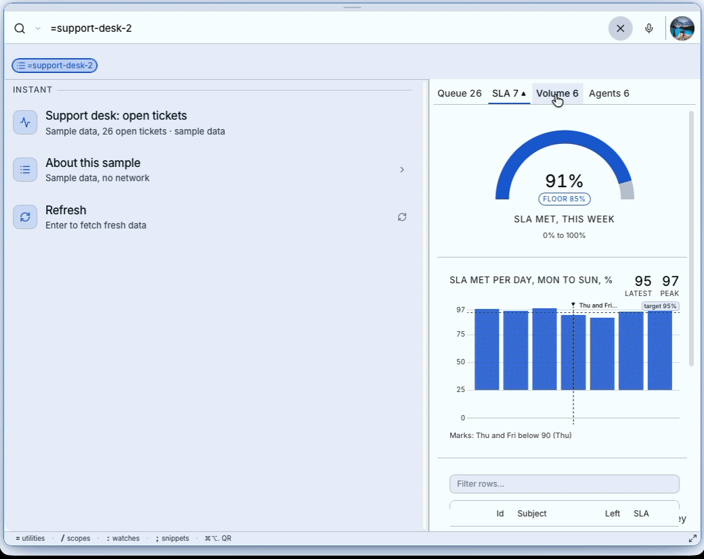

The support desk app, Queue tab: the team rating and the oldest open ticket as tiles, a filter box, then the open tickets with the age of each as a bar and a tone mark for the SLA state. The SLA tab then shows the week at 91 percent as a gauge with the 85 percent floor under it, then SLA met per day as bars against a 95 percent target line with the days it slipped marked. The gauge pane needs Bolt 0.1.182 or newer, the chart limit line and the marks 0.1.184, and the tabs 0.1.185, which is not in a public release yet. The pictures are unedited captures of a real Bolt running this example on its sample data.

- Example: [`support-desk`](../kit/examples/support-desk)
- Capability row: `widget.gauge` (0.1.182), `widget.chart` (0.1.181), `pane.chart_limit_marker` (0.1.184), `widget.tabs` (0.1.185)
- How to get this: Copy `kit/examples/support-desk`; the SLA tab is a `kind: stack` with a `kind: gauge` child (0.1.182) and a bar `kind: chart` with `limit` and `marker`.

## Tiles, a spend chart and tables

The marketing campaigns app, Overview tab: spend, ROI, conversions, budget used, click rate and cost per sale as tiles, then spend by channel as a donut chart, then weekly spend as a line against the weekly average with the events marked. The donut chart needs Bolt 0.1.182 or newer and the tabs 0.1.185, which is not in a public release yet. The picture is an unedited capture of a real Bolt running this example on its sample data.

- Example: [`marketing-campaigns`](../kit/examples/marketing-campaigns)
- Capability row: `widget.cards` (0.1.181), `widget.chart_182` (0.1.182), `widget.tabs` (0.1.185)
- How to get this: Copy `kit/examples/marketing-campaigns`; the Overview tab is a `kind: stack` with a `kind: cards` child and two `kind: chart` children, one of them with `type: donut` (0.1.182).

## A savings ring, a spend chart and a teams table

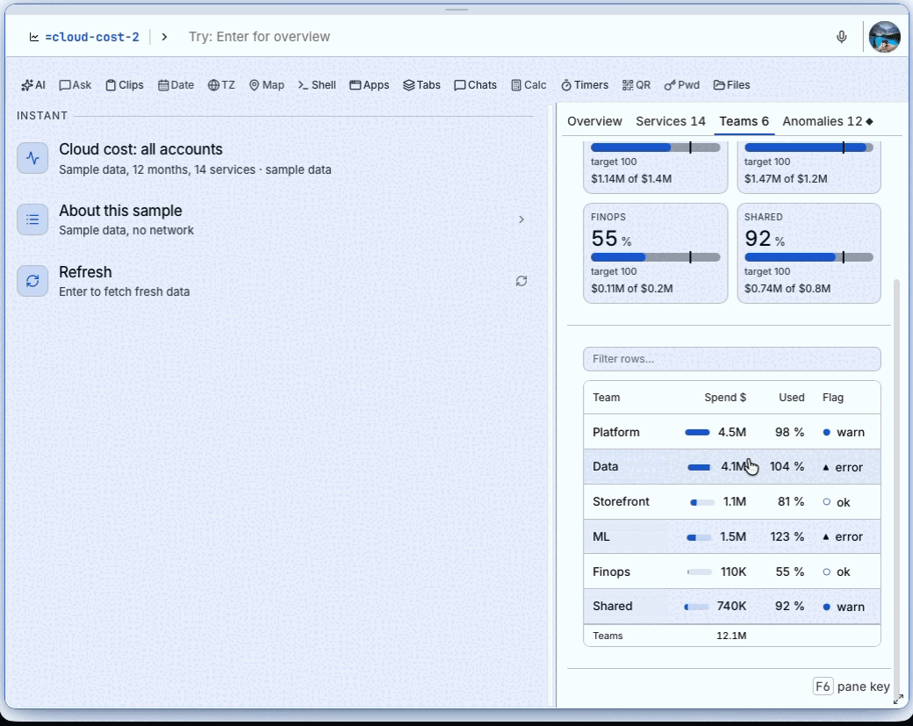

The cloud cost app, Overview tab: the anomalies and the cost per order as tiles, the savings plan coverage as a gauge at 71 percent over the 60 percent floor, then the monthly spend by service as an area chart with the limit line and the SageMaker launch and savings plan budget marks. The Teams tab then shows the teams that spend the money, with the spend of each as a bar and a tone mark for the ones over budget. The gauge pane needs Bolt 0.1.182 or newer, the chart limit line and the marks 0.1.184, and the tabs 0.1.185, which is not in a public release yet. The pictures are unedited captures of a real Bolt running this example on its sample data.

- Example: [`cloud-cost`](../kit/examples/cloud-cost)
- Capability row: `widget.table` (0.1.181), `pane.table_bars_mark` (0.1.184), `widget.tabs` (0.1.185)
- How to get this: Copy `kit/examples/cloud-cost`; the Teams tab table gives one column `bars` and one column `mark`.

## A fix time ring with a target

The security posture app, Posture tab: open findings, critical open, past SLA, fixed this week, fixed within SLA and scan coverage as six tiles, then the median days to fix as a gauge at 20 days against the 14 day target. The gauge pane needs Bolt 0.1.182 or newer and the tabs 0.1.185, which is not in a public release yet. The picture is an unedited capture of a real Bolt running this example on its sample data.

- Example: [`security-posture`](../kit/examples/security-posture)
- Capability row: `widget.gauge` (0.1.182), `widget.cards` (0.1.181), `widget.tabs` (0.1.185), `pane.stack` (0.1.184)
- How to get this: Copy `kit/examples/security-posture`; the Posture tab is a `kind: stack` with a `kind: cards` child and a `kind: gauge` child (0.1.182).

## Tiles with meters, trends and badges

Compliance posture as tiles: a number, a meter and a status badge for each.

- Example: [`acme-dash`](../kit/examples/acme-dash)
- Capability row: `pane.tiles` (0.1.181), `widget.cards` (0.1.181)
- How to get this: Copy `kit/examples/acme-dash`; the overview view uses `kind: cards` with `bind.layout: "tiles"`.

## Drill and Back

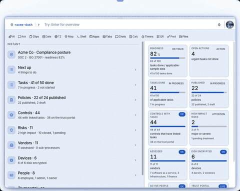

Press Enter on a row to drill in; the first row is always Back.

- Example: [`acme-dash`](../kit/examples/acme-dash)
- Capability row: `nav.drill` (0.1.181), `nav.back` (0.1.181)
- How to get this: Give the overview rows a `nav` and set `presentation.view_arg`; see `acme-dash/utilities/acme-dash.yaml`.

## Per-row detail pane with actions

Each story gets its own pane, with Open post and Copy quote.

- Example: [`pulse-feed`](../kit/examples/pulse-feed)
- Capability row: `pane.per_row` (0.1.181), `actions.footer` (0.1.181), `widget.entity_preview` (0.1.181)
- How to get this: Copy `kit/examples/pulse-feed`: an `entity_preview` pane plus a top-level `actions` list.

## Entity preview with a tile above

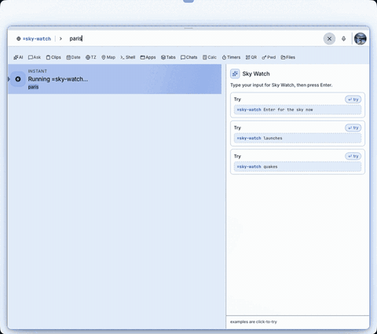

Type a city and get a temperature tile with the facts below.

- Example: [`sky-watch`](../kit/examples/sky-watch)
- Capability row: `widget.entity_preview` (0.1.181), `pane.tiles` (0.1.181)
- How to get this: Copy `kit/examples/sky-watch`: `bind.tiles_above` inside an `entity_preview`.

## Several live sources in one list

One word, four sources: the space station, launches, quakes and weather.

- Example: [`sky-watch`](../kit/examples/sky-watch)
- Capability row: `parallel.sources` (0.1.181), `api.keyless` (0.1.181)
- How to get this: Copy `kit/examples/sky-watch` (no key needed).

## Chart

A bar chart of daily spending next to the numbers.

- Example: [`expense-tracker`](../kit/examples/expense-tracker)
- Capability row: `widget.chart` (0.1.181), `pane.chart_mixed` (0.1.181)
- How to get this: Copy `kit/examples/expense-tracker`, the `chart` view (`kind: chart`, type bar).

## Tiles with a sparkline and a sample label

Spent this month against the budget, labelled as sample data.

- Example: [`expense-tracker`](../kit/examples/expense-tracker)
- Capability row: `pane.tiles` (0.1.181), `sample.mode` (0.1.181)
- How to get this: Copy `kit/examples/expense-tracker`; sample data shows until a key is added.

## Tabs in the right pane

=obs with Overview, Trend and Alerts as tabs over one list. Tabs need Bolt 0.1.185 or newer, which is not in a public release yet. The picture is an unedited capture of a real Bolt on public demo data.

- Example: [`tabs-gallery`](../kit/examples/tabs-gallery)
- Capability row: `widget.tabs` (0.1.185)
- How to get this: Copy `kit/examples/tabs-gallery` for the tabs.

## A table with a filter and marks

The =obs alerts as a table: a filter box, a mark per row and the open minutes. Public demo data.

- Example: [`widget-gallery`](../kit/examples/widget-gallery)
- Capability row: `widget.table` (0.1.181), `pane.table_bars_mark` (0.1.184)
- How to get this: Copy `kit/examples/widget-gallery` for a table with bars and marks.

## A trend with a limit line and event marks

Firing alerts over recent runs: a line, a dashed limit and marks where the count went over it. Public demo data.

- Example: [`widget-gallery`](../kit/examples/widget-gallery)
- Capability row: `widget.chart` (0.1.181), `pane.chart_limit_marker` (0.1.184)
- How to get this: Copy `kit/examples/widget-gallery` for a chart with a limit line and markers.

## Detail pane with Before, After and What changed

A change shown as Before and After next to the run list.

- Example: [`pipeline-board`](../kit/examples/pipeline-board)
- Capability row: `widget.detail` (0.1.181)
- How to get this: Copy `kit/examples/pipeline-board`, the `changes` view.

## Row Open and Copy (a place in Maps)

Each place opens in the browser map and copies as text.

- Example: [`places-list`](../kit/examples/places-list)
- Capability row: `actions.maps_link` (0.1.181), `actions.row` (0.1.181)
- How to get this: Copy `kit/examples/places-list`; the row carries `open_url`.

## Form app

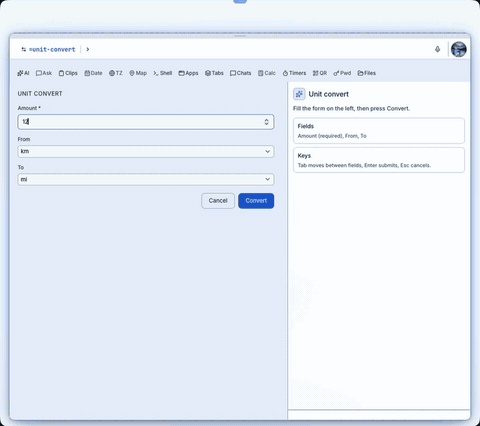

Fill Amount, From and To, press Convert.

- Example: [`unit-convert`](../kit/examples/unit-convert)
- Capability row: `inputs.form` (0.1.181)
- How to get this: Copy `kit/examples/unit-convert`; `inputs` plus `submit.label`.

## Form result and detail pane

One row per unit; the pane shows result, formula and reverse.

- Example: [`unit-convert`](../kit/examples/unit-convert)
- Capability row: `widget.detail` (0.1.181)
- How to get this: Same example; `right_widget.kind: detail`.

## Install flow

Review what the pack can do, accept, then approve the first run.

- Example: [`acme-dash`](../kit/examples/acme-dash)
- Capability row: `platform.reapprove` (0.1.181), `permissions.block` (0.1.181)
- How to get this: Drop the `.boltpack` on the launcher; see `kit/examples/QUICKSTART.md`.

## Terminal flow

`new`, `check`, `ship`: from template to a pack you can install (the app is named my-tool).

- Example: [`script-template`](../kit/examples/script-template)
- Capability row: none
- How to get this: See `kit/examples/QUICKSTART.md`.

## Four panes in one view

A wellness benefit on one pane: a ring, four tiles, a trend chart against an even pace, then the claims list. The gauge pane and the area chart need Bolt 0.1.182 or newer, and the stack pane 0.1.184, so this example needs Bolt 0.1.184. The picture is drawn by Bolt's own pane renderer from this example's sample data, not a capture of a running Bolt.

- Example: [`gym`](../kit/examples/gym)
- Capability row: `pane.stack` (0.1.184), `widget.gauge` (0.1.182), `widget.cards` (0.1.181), `widget.chart` (0.1.181), `widget.table` (0.1.181)
- How to get this: Copy `kit/examples/gym`; the overview view uses `kind: stack` with `bind.children`, one child per pane, and `visual_from` so every tile picks its own visual.

## A tile row, then a chart per takeaway

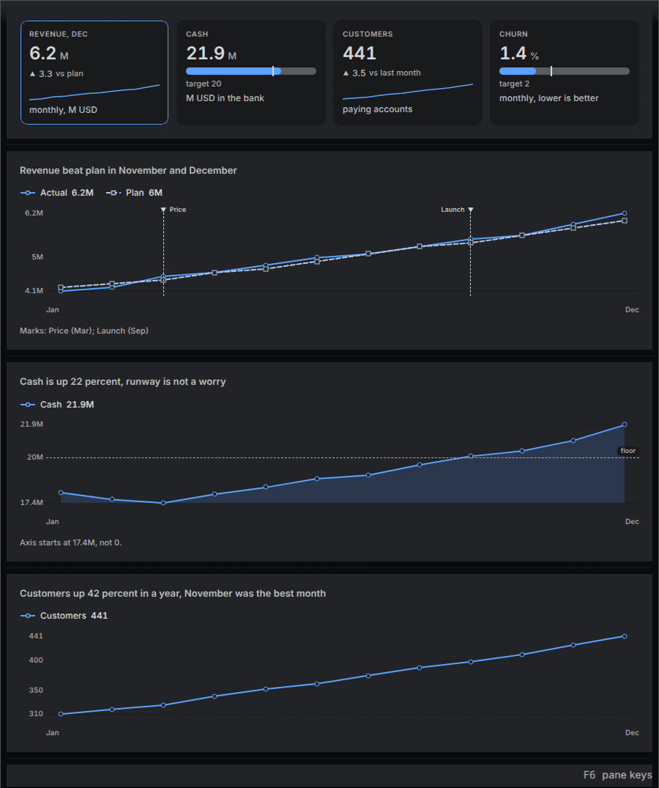

Four tiles, then one chart per takeaway: revenue against plan, cash against a floor, and customers. The stack pane needs Bolt 0.1.184 or newer and the area chart 0.1.182. The picture is drawn by Bolt's own pane renderer from this example's sample data, not a capture of a running Bolt.

- Example: [`exec-brief`](../kit/examples/exec-brief)
- Capability row: `pane.stack` (0.1.184), `widget.cards` (0.1.181), `widget.chart` (0.1.181)
- How to get this: Copy `kit/examples/exec-brief`; every chart carries a `label` that states the takeaway, and `marker` puts an event on the chart.

## A pipeline in one pane

Open pipeline against commit, the four numbers that matter, the stage funnel and the top ten deals. The stack pane needs Bolt 0.1.184 or newer and the area chart 0.1.182. The picture is drawn by Bolt's own pane renderer from this example's sample data, not a capture of a running Bolt.

- Example: [`sales-pipeline`](../kit/examples/sales-pipeline)
- Capability row: `pane.stack` (0.1.184), `widget.cards` (0.1.181), `widget.chart` (0.1.181), `widget.table` (0.1.181), `pane.table_bars_mark` (0.1.184)
- How to get this: Copy `kit/examples/sales-pipeline`; the funnel table uses column `bars` and `mark`, and the deals table sums the column.

## Not shown yet

JSON tree, branch explorer, repo-radar chart and the around example with live data have no clean recording yet.
