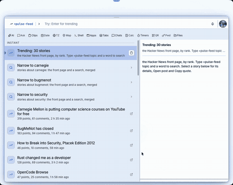
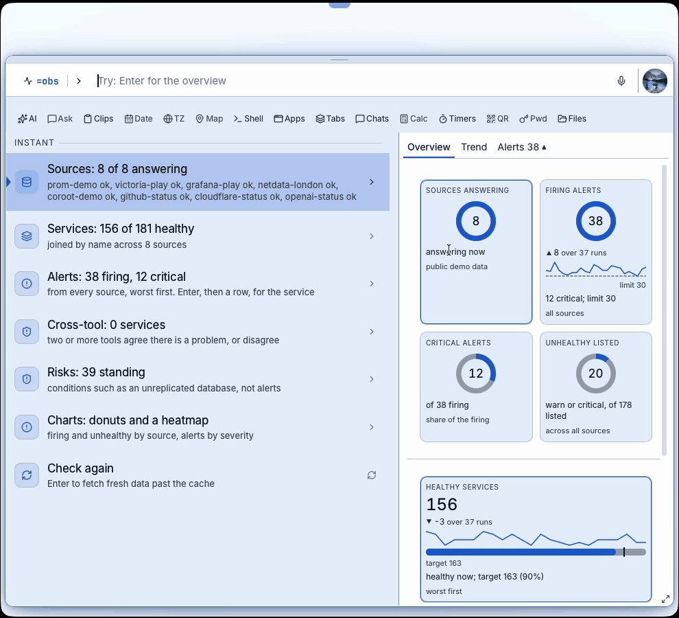
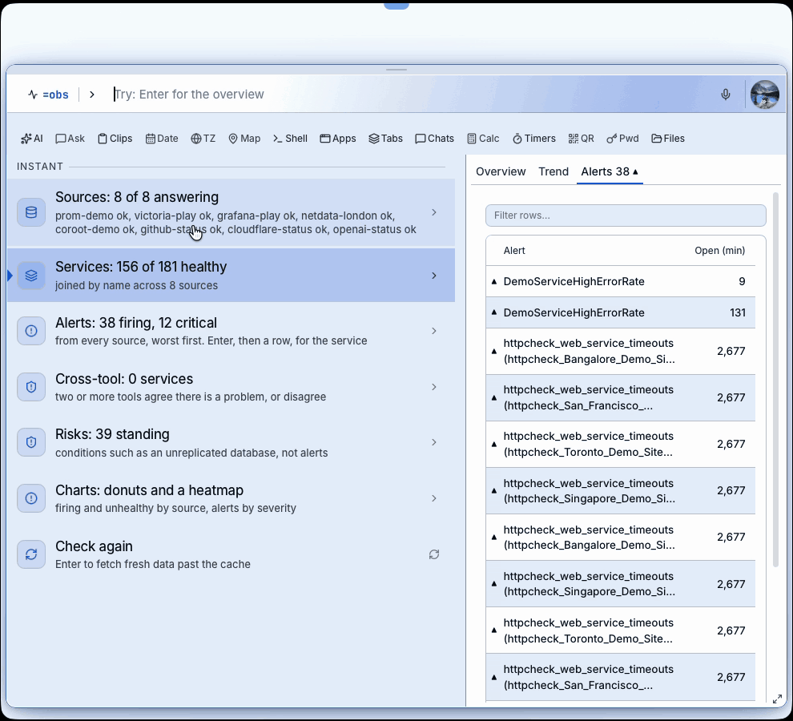
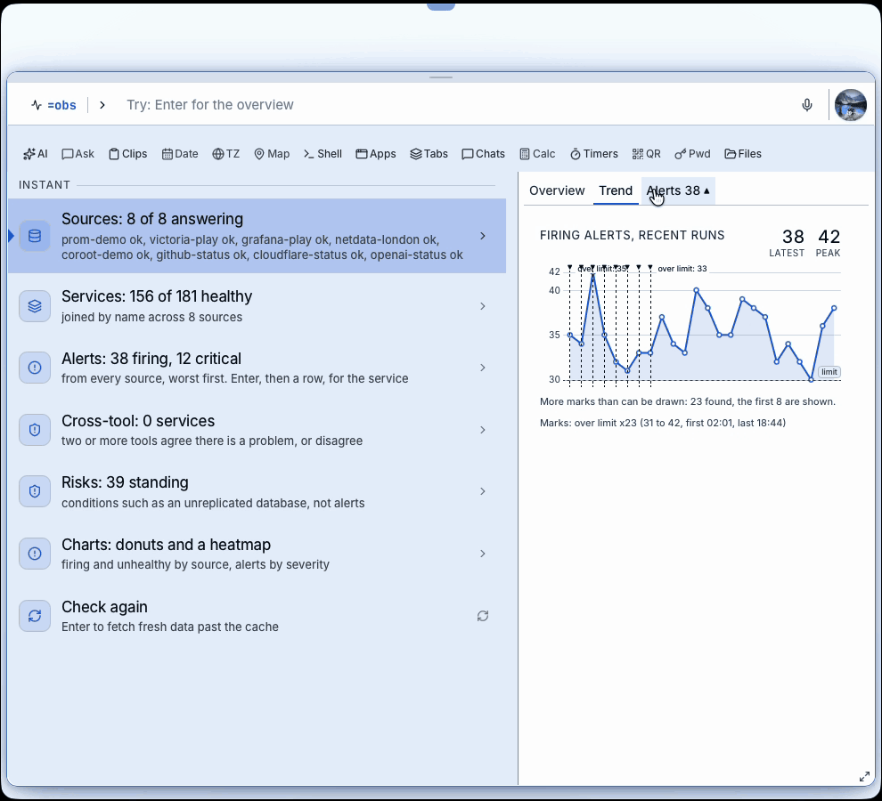
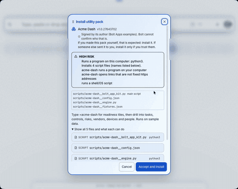

# See it in action

Real Bolt screens for each example app. Sample data is labelled in the pictures (SAMPLE chips or rows). Each entry names the example folder under `kit/examples/` and the row in [`kit/examples/capabilities.json`](../kit/examples/capabilities.json). The key behind each number is in [Anatomy of a Bolt App](anatomy.md). The 76 second video, with captions, is on the site: [sparcle.app/docs/extend/rich-apps](https://sparcle.app/docs/extend/rich-apps).

This page is generated from `docs/gallery.json`, which the website reads too.

## Tiles with meters, trends and badges

Compliance posture as tiles: a number, a meter and a status badge for each.

- Example: [`acme-dash`](../kit/examples/acme-dash)
- Capability row: `pane.tiles`, `widget.cards`
- How to get this: Copy `kit/examples/acme-dash`; the overview view uses `kind: cards` with `bind.layout: "tiles"`.

## Drill and Back

Press Enter on a row to drill in; the first row is always Back.

- Example: [`acme-dash`](../kit/examples/acme-dash)
- Capability row: `nav.drill`, `nav.back`
- How to get this: Give the overview rows a `nav` and set `presentation.view_arg`; see `acme-dash/utilities/acme-dash.yaml`.

## Per-row detail pane with actions

Each story gets its own pane, with Open post and Copy quote.

- Example: [`pulse-feed`](../kit/examples/pulse-feed)
- Capability row: `pane.per_row`, `actions.footer`, `widget.entity_preview`
- How to get this: Copy `kit/examples/pulse-feed`: an `entity_preview` pane plus a top-level `actions` list.

## Entity preview with a tile above

Type a city and get a temperature tile with the facts below.

- Example: [`sky-watch`](../kit/examples/sky-watch)
- Capability row: `widget.entity_preview`, `pane.tiles`
- How to get this: Copy `kit/examples/sky-watch`: `bind.tiles_above` inside an `entity_preview`.

## Several live sources in one list

One word, four sources: the space station, launches, quakes and weather.

- Example: [`sky-watch`](../kit/examples/sky-watch)
- Capability row: `parallel.sources`, `api.keyless`
- How to get this: Copy `kit/examples/sky-watch` (no key needed).

## Chart

A bar chart of daily spending next to the numbers.

- Example: [`expense-tracker`](../kit/examples/expense-tracker)
- Capability row: `widget.chart`, `pane.chart_mixed`
- How to get this: Copy `kit/examples/expense-tracker`, the `chart` view (`kind: chart`, type bar).

## Tiles with a sparkline and a sample label

Spent this month against the budget, labelled as sample data.

- Example: [`expense-tracker`](../kit/examples/expense-tracker)
- Capability row: `pane.tiles`, `sample.mode`
- How to get this: Copy `kit/examples/expense-tracker`; sample data shows until a key is added.

## Tabs in the right pane

=obs with Overview, Trend and Alerts as tabs over one list. Tabs need Bolt 0.1.185 or newer, which is not in a public release yet. The picture is an unedited capture of a real Bolt on public demo data.

- Example: [`tabs-gallery`](../kit/examples/tabs-gallery)
- Capability row: `widget.tabs`
- How to get this: Copy `kit/examples/tabs-gallery` for the tabs.

## A table with a filter and marks

The =obs alerts as a table: a filter box, a mark per row and the open minutes. Public demo data.

- Example: [`widget-gallery`](../kit/examples/widget-gallery)
- Capability row: `widget.table`, `pane.table_bars_mark`
- How to get this: Copy `kit/examples/widget-gallery` for a table with bars and marks.

## A trend with a limit line and event marks

Firing alerts over recent runs: a line, a dashed limit and marks where the count went over it. Public demo data.

- Example: [`widget-gallery`](../kit/examples/widget-gallery)
- Capability row: `widget.chart`, `pane.chart_limit_marker`
- How to get this: Copy `kit/examples/widget-gallery` for a chart with a limit line and markers.

## Detail pane with Before, After and What changed

A change shown as Before and After next to the run list.

- Example: [`pipeline-board`](../kit/examples/pipeline-board)
- Capability row: `widget.detail`
- How to get this: Copy `kit/examples/pipeline-board`, the `changes` view.

## Row Open and Copy (a place in Maps)

Each place opens in the browser map and copies as text.

- Example: [`places-list`](../kit/examples/places-list)
- Capability row: `actions.maps_link`, `actions.row`
- How to get this: Copy `kit/examples/places-list`; the row carries `open_url`.

## Form app

Fill Amount, From and To, press Convert.

- Example: [`unit-convert`](../kit/examples/unit-convert)
- Capability row: `inputs.form`
- How to get this: Copy `kit/examples/unit-convert`; `inputs` plus `submit.label`.

## Form result and detail pane

One row per unit; the pane shows result, formula and reverse.

- Example: [`unit-convert`](../kit/examples/unit-convert)
- Capability row: `widget.detail`
- How to get this: Same example; `right_widget.kind: detail`.

## Install flow

Review what the pack can do, accept, then approve the first run.

- Example: [`acme-dash`](../kit/examples/acme-dash)
- Capability row: `platform.reapprove`, `permissions.block`
- How to get this: Drop the `.boltpack` on the launcher; see `kit/examples/QUICKSTART.md`.

## Terminal flow

`new`, `check`, `ship`: from template to a pack you can install (the app is named my-tool).

- Example: [`script-template`](../kit/examples/script-template)
- Capability row: none (command line flow)
- How to get this: See `kit/examples/QUICKSTART.md`.

## Not shown yet

Table pane, JSON tree, branch explorer, repo-radar chart and the around example with live data have no clean recording yet.
